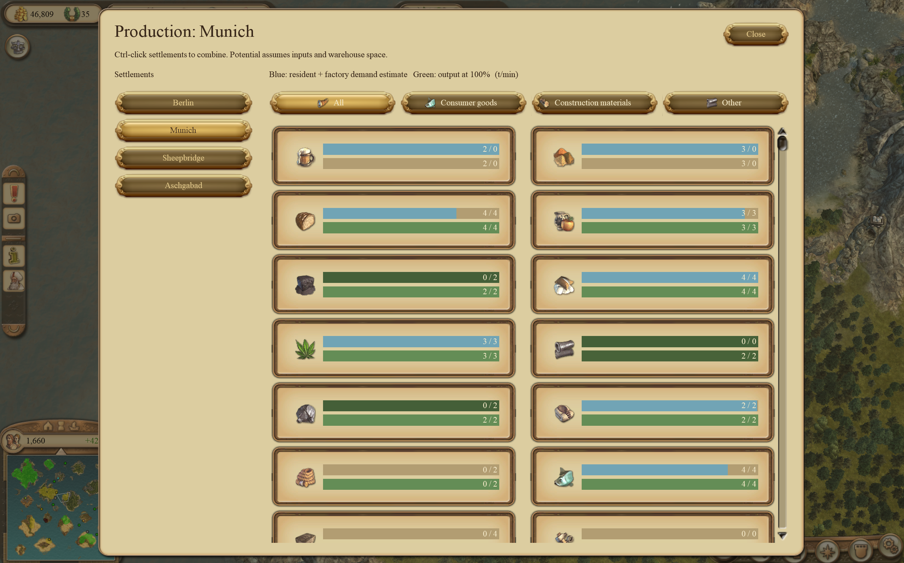

# Anno 1404 Production Menu

An experimental in-game production overview for Anno 1404 Venice, with a standalone GUI authoring tool and reverse-engineering utilities.



## Install the mod

**Download the matching ZIP from [Releases](https://github.com/waldi/anno-1404-production-menu/releases). You do not need to build the code or install Ghidra, Python, Node, GUI Studio or any developer tools.**

1. Choose the **Production-Menu** archive for your edition:

   | Your game | ZIP filename ends with | Game executable |
   | --- | --- | --- |
   | GOG Gold Edition / Venice | `-gog.zip` | `Addon.exe` (2.01.5010) |
   | Ubisoft History Edition / Venice | `-history-edition.zip` | `Anno1404Addon.exe` (4.0.4253.0) |

2. **Close the game**, then extract the ZIP. If your game folder already contains `d3d9.dll`, back it up first; another mod may use it.
3. Open the game installation folder containing the executable above. Copy these four files directly into that folder:
   - `d3d9.dll`
   - `AnnoRECompanion.exe`
   - `production_dialog_v5.dlg`
   - `production_button.dlg`
4. **History Edition only:** also copy `ANNORE_HISTORY_NATIVE.flag` into the same folder.
5. Start Venice in **DirectX 9 mode**, load a game, and press **Ctrl+Q** to open or close Production. The DLL starts the companion automatically.

Select a settlement on the left; Ctrl-click settlements to combine them. Use the goods filters and scroll through the list. Production rates are estimates, not measured deliveries: full warehouses or missing inputs can prevent actual output. Both edition packages remain experimental and reject unsupported executable builds.

**To uninstall:** close the game, remove only the mod files you copied, and restore any previous `d3d9.dll` backup. Your saved games do not need to be removed.

If the menu does not open, check the edition ZIP, executable version, DirectX 9 mode and that the files are beside the executable rather than inside an extra extracted folder. History also requires the activation flag. See the [mod guide](tools/production-menu/README.md) for details.

## Repository components

| Component | Purpose | Source |
| --- | --- | --- |
| Production Menu | Native in-game panel; separate GOG x86 and History x64 packages | [tools/production-menu](tools/production-menu/README.md) |
| Anno GUI Studio | Windows x64 desktop editor and preview for game GUI definitions | [tools/gui_editor](tools/gui_editor/STANDALONE.md) |
| Research tools | Live population, production and GUI inspection, probes and debugging | [tools/research](tools/research/README.md) |

[Download releases](https://github.com/waldi/anno-1404-production-menu/releases). Production Menu supports the exact executable builds listed in its installation guide and requires DirectX 9. GUI Studio requires WebView2, your own game installation and separately supplied RDA Explorer dependencies. The editor saves working copies rather than installing edits.

Research memory readers use read-only process handles. The Production Menu DLL runs inside the game and hooks/writes its GUI. Debugging and development helpers have additional side effects; consult their documentation before using them. Current/potential production estimates are distinct from actual delivered flow.

## Development

```powershell
./tools/ci.ps1 -Product production-menu
./tools/ci.ps1 -Product gui-studio
./tools/ci.ps1 -Product research
```

Native builds require MSVC x86/x64 tools. Studio requires Node (version in .node-version), pinned Rust and MSVC. Public CI builds from source without game assets. Local fidelity checks require extracted resources and captures; see [build and release instructions](docs/releasing.md).

## Knowledge base

- [AGENTS.md](AGENTS.md): repository safety and verification rules.
- [findings.json](docs/findings.json): runtime contracts, confidence and evidence.
- [production](docs/production.md), [GUI system](docs/gui-system.md), [edition compatibility](docs/edition-compatibility.md): research context.
- Ghidra is the canonical static structure/function source; its local database and game/dependency trees are excluded from Git.

**This repository does not include Ghidra, the Ghidra MCP integration, annotated Ghidra projects, game binaries or extracted game resources.** These are local research prerequisites, not requirements for installing the mod or building its release packages. See [local research setup](docs/local-research-setup.md) before following investigation commands.

Original project code is licensed under [GNU GPL v3](LICENSE) (GPL-3.0-only). Game resources are not licensed by this project and are not included in release archives. See [third-party and fixture notes](THIRD_PARTY_NOTICES.md).
